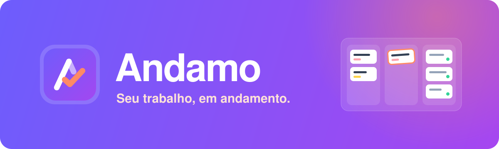
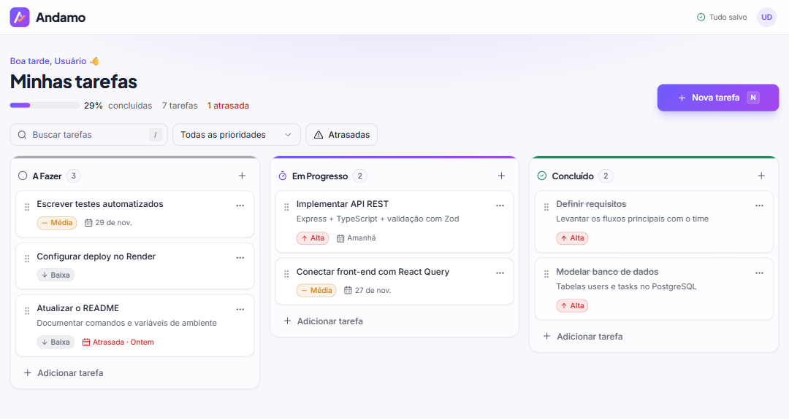

<p align="center">
  
</p>

<p align="center">
  
  
  
  
  
</p>

# Andamo

**Andamo** (de *andamento*) é um quadro de tarefas Kanban full stack: rápido, acessível e sincronizado na nuvem.
Desenvolvido por **Israel Alcantara** — evolução do antigo projeto *TaskFlow*.

<p align="center">
  
  
</p>
<p align="center">
  
</p>

### A marca

O símbolo é um **“A” cuja perna direita se completa num check** coral: o trabalho em andamento chegando ao
*concluído*. Paleta: violeta `#6D5DFC` → púrpura `#A646F0`, com destaque coral `#FF8A65`.
Tipografia: **Plus Jakarta Sans** (títulos) e **Inter** (texto). Arquivos em [`docs/brand`](docs/brand).

## Stack

- **Front-end:** React 18 + TypeScript + Vite + Tailwind + shadcn/ui + React Query + dnd-kit
- **API:** Node.js + Express 5 + TypeScript + Zod + JWT
- **Banco:** PostgreSQL (Neon) com SQL parametrizado (`pg`) e migrações versionadas
- **Monorepo:** npm workspaces (`apps/web`, `apps/api`, `packages/shared`)

## Funcionalidades

**Plataforma SaaS de gestão de projetos, tarefas e equipes.** Estado detalhado de cada item no [ROADMAP](ROADMAP.md).

- **Workspaces multi-tenant**: workspace pessoal automático + workspaces de equipe, convites por e-mail,
  equipes, 6 papéis (proprietário → visualizador) validados no servidor, limites por plano (Free/Pro/Business)
- **Projetos**: templates, duplicação, arquivo, cores, objetivos, datas e progresso
- **Tarefas**: Kanban com arrastar e soltar, lista agrupável, tabela, timeline/Gantt e calendário; subtarefas,
  checklist, dependências, recorrência, múltiplos responsáveis, etiquetas, lixeira, ações em massa
- **Colaboração em tempo real** (WebSocket): comentários com @menções, respostas e reações, presença
- **Notificações**: central com contador, push (Service Worker + VAPID), e-mail (Resend), lembretes de prazo
  configuráveis em fila durável, horário silencioso e não perturbe
- **Segurança**: refresh token rotativo, sessões revogáveis, 2FA (TOTP), bloqueio por força bruta, LGPD
  (exportar/excluir conta) — ver [SECURITY.md](SECURITY.md)
- **Dashboard** com dados reais, **busca global** (Ctrl+K), **landing page** comercial e **PWA** instalável

## Documentação

| Arquivo | Conteúdo |
|---|---|
| [REQUISITOS.md](REQUISITOS.md) | Escopo completo do produto |
| [ROADMAP.md](ROADMAP.md) | Estado de cada funcionalidade e próximos passos |
| [ARCHITECTURE.md](ARCHITECTURE.md) | Arquitetura, multi-tenant, fila, notificações, decisões |
| [SECURITY.md](SECURITY.md) | Controles de segurança, LGPD, backup e rollback |
| [CHANGELOG.md](CHANGELOG.md) | Histórico de versões |
| [CLAUDE.md](CLAUDE.md) | Guia para sessões de desenvolvimento |

API: especificação em `GET /v1/openapi.json`; saúde em `/health` e `/health/ready`.

## Integrações opcionais

Ficam desligadas (sem fingir funcionamento) até você configurar as variáveis em `apps/api/.env` / Render:

| Recurso | Variáveis |
|---|---|
| E-mail (verificação, senha, convites, lembretes, resumos) | `RESEND_API_KEY`, `EMAIL_FROM` |
| Notificações push | `VAPID_PUBLIC_KEY`, `VAPID_PRIVATE_KEY` (gere com `npx web-push generate-vapid-keys`) |
| Login com Google | `GOOGLE_CLIENT_ID` |
| Formulário de contato por e-mail | `CONTACT_EMAIL` |

## Como rodar (Windows / PowerShell)

Pré-requisito: Node.js 22+.

```powershell
git clone https://github.com/Israelksilva/TaskFlow.git
cd TaskFlow

# 1. Dependências
npm install

# 2. Variáveis de ambiente da API (edite DATABASE_URL com a URL do Neon)
Copy-Item apps\api\.env.example apps\api\.env   # se ainda não existir
notepad apps\api\.env

# 3. Migração (e dados de exemplo, opcional)
npm run db:migrate
npm run db:seed          # usuário demo@andamo.dev / demo1234

# 4. API (http://localhost:3333) + front-end (http://localhost:8080)
npm run dev
# ou em terminais separados: npm run dev:api  /  npm run dev:web
```

Sem Neon? Use `DATABASE_URL="pglite://./.data/dev"` (PostgreSQL embutido, só para desenvolvimento).
Com PGlite, não rode `db:seed` com a API ligada: o banco embutido aceita um processo por vez.

### Variáveis de ambiente

- `apps/api/.env` — **somente no servidor**: `DATABASE_URL`, `JWT_SECRET`, `PORT`, `CORS_ORIGIN`…
- `apps/web/.env` — apenas `VITE_API_URL` (pública). Em desenvolvimento é `/api`, repassado pelo proxy do Vite.

## Scripts

| Comando | O que faz |
|---|---|
| `npm run dev` | API + front em modo desenvolvimento |
| `npm test` | Testes de shared, API e web |
| `npm run lint` / `npm run typecheck` | Qualidade |
| `npm run build` | Build da API (`apps/api/dist`) e do front (`apps/web/dist`) |
| `npm run db:migrate` / `npm run db:seed` | Banco |

## Deploy (próxima etapa)

- **API no Render:** `render.yaml` já está pronto (usa `PORT`, health check em `/health`, aplica migrações no start).
- **Front:** defina `VITE_API_URL` com a URL do Render e publique `apps/web/dist` (ex.: GitHub Pages com `npm run deploy -w @andamo/web`). Inclua a origem do front em `CORS_ORIGIN`.

---

Feito com 💜 por Israel Alcantara.
