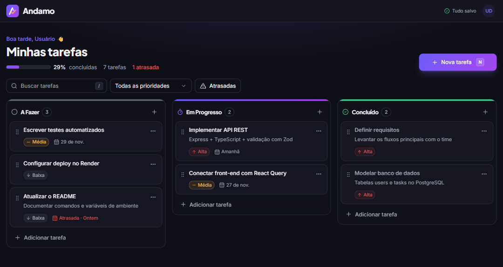
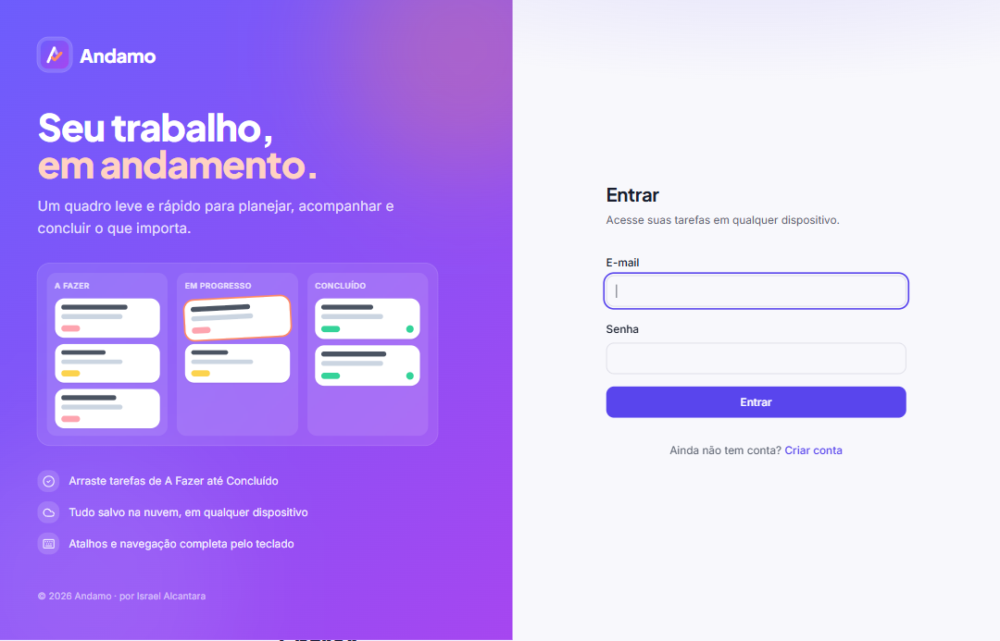

<p align="center">
  
</p>

<p align="center">
  
  
  
  
  
</p>

# Andamo

**Andamo** (de *andamento*) é um quadro de tarefas Kanban full stack: rápido, acessível e sincronizado na nuvem.
Desenvolvido por **Israel Alcantara** — evolução do antigo projeto *TaskFlow*.

<p align="center">
  
  
</p>
<p align="center">
  
</p>

### A marca

O símbolo é um **“A” cuja perna direita se completa num check** coral: o trabalho em andamento chegando ao
*concluído*. Paleta: violeta `#6D5DFC` → púrpura `#A646F0`, com destaque coral `#FF8A65`.
Tipografia: **Plus Jakarta Sans** (títulos) e **Inter** (texto). Arquivos em [`docs/brand`](docs/brand).

## Stack

- **Front-end:** React 18 + TypeScript + Vite + Tailwind + shadcn/ui + React Query + dnd-kit
- **API:** Node.js + Express 5 + TypeScript + Zod + JWT
- **Banco:** PostgreSQL (Neon) com SQL parametrizado (`pg`) e migrações versionadas
- **Monorepo:** npm workspaces (`apps/web`, `apps/api`, `packages/shared`)

## Funcionalidades

- Cadastro/login; cada usuário vê apenas as próprias tarefas
- Sessão renovada automaticamente, "manter conectado", sessões ativas e encerrar outras
- Verificação em duas etapas (app autenticador + códigos de recuperação), força da senha e mostrar/ocultar
- Verificação de e-mail e recuperação de senha (com e-mail configurado); login com Google (com credenciais configuradas)
- Configurações da conta: nome, fuso, tema, senha, segurança e sessões
- Quadro com colunas **A Fazer**, **Em Progresso** e **Concluído**
- Criar, editar (PATCH parcial), excluir (com confirmação) e mover tarefas
- Mover por **arrastar e soltar** (mouse, toque e teclado) ou pelo menu **⋯ → Mover para**
- Ordem dos cartões persistida no banco (coluna + posição)
- Busca sem acentos, filtro por prioridade e por atrasadas
- Atualização otimista com **rollback** e "Tentar novamente" quando a API falha
- Indicador "Salvando… / Tudo salvo", estados de carregando, vazio e sem resultados
- Layout responsivo: no celular, uma coluna por vez em abas + botão flutuante "Nova tarefa"
- Acessibilidade: rótulos, foco visível, retorno de foco ao fechar modais, anúncios em português
- Atalhos: <kbd>N</kbd> nova tarefa · <kbd>/</kbd> buscar · <kbd>Ctrl</kbd>+<kbd>Enter</kbd> salvar
- Importa tarefas antigas salvas no `localStorage` (versão anterior), sem apagar a cópia local
- Tema claro/escuro
- Landing pública em `/` (app em `/#/app`), formulário de contato, Política de Privacidade e Termos de Uso

## Estrutura

```
apps/
  api/                 API REST (Express)
    migrations/        SQL versionado (001_create_users_and_tasks.sql)
    src/
      config/env.ts    validação das variáveis de ambiente (Zod)
      db/              conexão (pg / PGlite), migrador e seed
      middlewares/     autenticação JWT e tratamento de erros
      modules/
        auth/          cadastro, login, /me
        tasks/         rotas → controller → service → repository (SQL)
        users/
    tests/             testes de integração (Supertest + Postgres em memória)
  web/                 SPA React
    src/
      features/auth/   login, cadastro, sessão
      features/tasks/  quadro, cartões, formulário, hooks React Query
      components/      layout, feedback e componentes de UI (shadcn)
packages/
  shared/              schemas Zod, tipos e regras de domínio usados pelos dois lados
```

## API

Rotas de tarefas e de conta exigem `Authorization: Bearer <accessToken>` (15 min). O front renova com
`POST /auth/sessao/renovar` usando o `refreshToken`, que muda a cada renovação. Documentação completa em
`/docs` (OpenAPI) com a API rodando.

| Método | Rota | Descrição | Respostas |
|---|---|---|---|
| GET | `/auth/config` | O que está ligado (e-mail, Google) | 200 |
| POST | `/auth/cadastro` | Cria conta e abre sessão | 201, 409, 422 |
| POST | `/auth/login` | Autentica (ou pede o 2FA) | 200, 401, 422, 429 |
| POST | `/auth/2fa/login` | Conclui o login com o código | 200, 401, 422 |
| POST | `/auth/sessao/renovar` | Troca o refresh token | 200, 401 |
| POST | `/auth/sair` | Encerra a sessão atual | 204 |
| GET | `/auth/me` | Usuário atual | 200, 401 |
| POST | `/auth/email/verificar` · `/auth/email/reenviar` | Verificação de e-mail | 200/202 |
| POST | `/auth/senha/esqueci` · `/auth/senha/redefinir` | Recuperação de senha | 202/204, 422 |
| POST/GET | `/auth/google/*` | Login com Google (OAuth + PKCE) | 200, 303, 503 |
| PATCH | `/conta` | Nome, idioma, fuso | 200, 422 |
| POST | `/conta/senha` | Troca ou define a senha | 200, 422 |
| GET/DELETE | `/conta/sessoes` · `/conta/sessoes/:id` | Sessões ativas | 200/204 |
| POST | `/conta/2fa/configurar` · `ativar` · `desativar` · `codigos` | 2FA | 200, 409, 422 |
| GET | `/tarefas` | Lista (`?search=&status=&priority=`) | 200 |
| POST | `/tarefas` | Cria e devolve a tarefa com `id` | 201, 422 |
| PATCH | `/tarefas/:id` | Atualiza **só os campos enviados**; `status`/`position` reordenam | 200, 404, 422 |
| DELETE | `/tarefas/:id` | Exclui | 204, 404 |
| POST | `/tarefas/importar` | Importação em lote (atômica) | 201, 422 |
| POST | `/contato` | Mensagem do formulário da landing (público, anti-spam) | 201, 422, 429 |
| GET | `/health` | Health check | 200 |

Erros seguem o formato `{ "error": { "code", "message", "details?" } }`.

## Como rodar (Windows / PowerShell)

Pré-requisito: Node.js 22+.

```powershell
git clone https://github.com/Israelksilva/TaskFlow.git
cd TaskFlow

# 1. Dependências
npm install

# 2. Variáveis de ambiente da API (edite DATABASE_URL com a URL do Neon)
Copy-Item apps\api\.env.example apps\api\.env   # se ainda não existir
notepad apps\api\.env

# 3. Migração (e dados de exemplo, opcional)
npm run db:migrate
npm run db:seed          # usuário demo@andamo.dev / demo1234

# 4. API (http://localhost:3333) + front-end (http://localhost:8080)
npm run dev
# ou em terminais separados: npm run dev:api  /  npm run dev:web
```

Sem Neon? Use `DATABASE_URL="pglite://./.data/dev"` (PostgreSQL embutido, só para desenvolvimento).
Com PGlite, não rode `db:seed` com a API ligada: o banco embutido aceita um processo por vez.

### Variáveis de ambiente

- `apps/api/.env` — **somente no servidor**: `DATABASE_URL`, `JWT_SECRET`, `PORT`, `CORS_ORIGIN`,
  `APP_URL`, `API_PUBLIC_URL`, `DATA_ENCRYPTION_KEY` e, opcionais, `RESEND_API_KEY`/`MAIL_FROM` e
  `GOOGLE_CLIENT_ID`/`GOOGLE_CLIENT_SECRET` (modelo comentado em `apps/api/.env.example`). Em
  desenvolvimento, sem Resend, os e-mails ficam em `apps/api/.data/mails/*.html`.
- `apps/web/.env` — apenas valores públicos: `VITE_API_URL` (em desenvolvimento `/api`, repassado pelo proxy do Vite) e `VITE_SITE_URL` (URL pública usada em SEO, Open Graph e sitemap; padrão `https://israelksilva.github.io/TaskFlow/`).

## Scripts

| Comando | O que faz |
|---|---|
| `npm run dev` | API + front em modo desenvolvimento |
| `npm test` | Testes de shared, API e web |
| `npm run test:e2e` | E2E (Playwright) com auditoria de acessibilidade |
| `npm run lint` / `npm run typecheck` | Qualidade |
| `npm run build` | Build da API (`apps/api/dist`) e do front (`apps/web/dist`) |
| `npm run db:migrate` / `npm run db:seed` | Banco |

## Ligar e-mail e login com Google (produção)

**E-mail (Resend):**

1. Crie uma conta em [resend.com](https://resend.com). Sem domínio próprio, o Resend só envia para o
   e-mail da própria conta (bom para testar); para enviar a qualquer pessoa, verifique um domínio em
   *Domains*.
2. Em *API Keys*, crie uma chave com permissão de envio.
3. No Render (serviço da API → *Environment*): `RESEND_API_KEY` = a chave e `MAIL_FROM` =
   `Andamo <nao-responda@seu-dominio>`; confira `APP_URL` (endereço do front, com `/` no fim).

**Google:**

1. Em [console.cloud.google.com](https://console.cloud.google.com), crie um projeto e configure a
   *Tela de permissão OAuth* (tipo Externo; escopos `openid`, `email`, `profile`).
2. *Credenciais → Criar credenciais → ID do cliente OAuth → Aplicativo da Web*. Em *URIs de
   redirecionamento autorizados*, coloque `https://<sua-api>.onrender.com/v1/auth/google/callback`.
3. No Render: `GOOGLE_CLIENT_ID`, `GOOGLE_CLIENT_SECRET` e `API_PUBLIC_URL` =
   `https://<sua-api>.onrender.com`.

Sem essas variáveis, as telas que dependem delas ficam ocultas automaticamente.

## Deploy (próxima etapa)

- **API no Render:** `render.yaml` já está pronto (usa `PORT`, health check em `/health`, aplica migrações no start).
- **Front:** defina `VITE_API_URL` com a URL do Render e publique `apps/web/dist` (ex.: GitHub Pages com `npm run deploy -w @andamo/web`). Inclua a origem do front em `CORS_ORIGIN`. O build injeta a CSP com a origem da API, então gere-o sempre com o `VITE_API_URL` de produção.

---

Feito com 💜 por Israel Alcantara.
